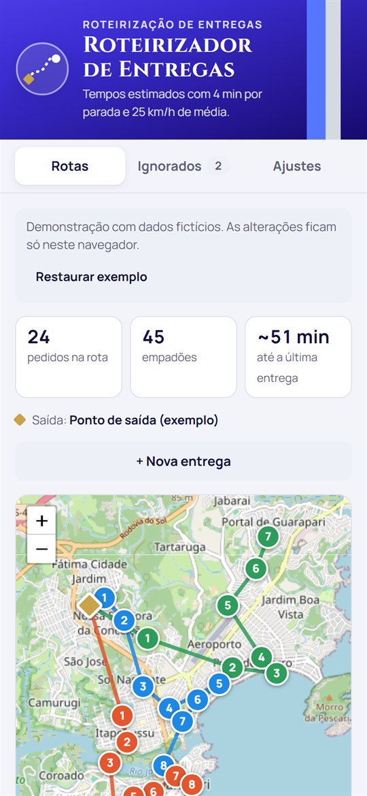
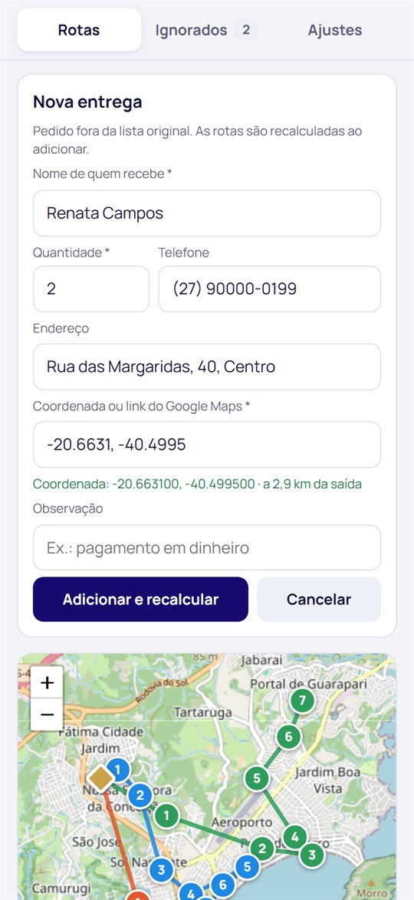

# Delivery Route Planner

Web app that splits home deliveries among several couriers and orders each route so the last delivery happens as early as possible. I built it for a charity pie sale in Guarapari, Brazil: 33 orders, 3 motorcycle couriers and one morning to deliver everything.

**Demo:** https://arthurnolasco.github.io/delivery-route-planner/ (fictional data, no login)

<p>
  
  
  
</p>

The interface is in Portuguese because the people using it are Brazilian. Code and docs are in English.

## The problem

The orders came as a spreadsheet with addresses and coordinates. Splitting them by neighbourhood left one courier with twice the work of the others, and the plan kept changing: a customer decided to pick up, an address was wrong, a late order came in. I wanted something the team could open on their phones, adjust on the spot and still get balanced routes.

## What it does

- Splits the orders among the couriers and orders each route.
- Recalculates everything when an order is removed, a skipped order is put back, a new order is added, a courier is added or removed, or the starting point changes.
- After a recalculation each courier keeps the route closest to the one they had, so a small change doesn't reshuffle the whole team.
- Shows the routes on a map (Leaflet + OpenStreetMap), with one colour per courier.
- Opens the full route in Google Maps and copies a text with names, phones and links to send on WhatsApp.
- Accepts coordinates in several formats, including a pasted Google Maps link.
- Keeps one shared plan for everyone through Firebase (Auth + Firestore), protected by a password.
- Runs in demo mode with fictional data when there is no Firebase config.

## How the routing works

It's a small Vehicle Routing Problem. For about 30 stops in a browser an exact solver isn't worth it, so `js/routing.js` uses a heuristic:

1. Each route's time is `distance / 25 km/h + 4 min per stop`. The score to minimise is `max(route times) * 1000 + sum(route times)`, so the slowest courier comes first and total time breaks ties.
2. Distance is the haversine distance times 1.35, a rough correction for streets. No routing API needed.
3. Stops are inserted one at a time, in random order, where they increase the score the least.
4. Then a local search runs until nothing improves: 2-opt inside a route, moving a stop to another position or route, and swapping stops between routes.
5. Steps 3 and 4 repeat 140 times from different random orders and the best result is kept. The random generator has a fixed seed, so every phone computes the same routes.

Orders at the same address count as one stop. For the real event (28 orders with coordinates, 3 couriers) it takes about 0.3 s on a laptop.

Limitations I know about: straight-line distance ignores one-way streets and the bay; there are no capacity limits or delivery time windows; and recalculating can move stops of a courier who is already on the road. A road distance matrix (OSRM, for example) and a "lock routes" option would be the next steps.

## Running it

It's a static site with no build step:

```bash
npx serve .        # or: python -m http.server 8000
```

Without `js/config.js` it opens in demo mode. Adding `?demo` to the URL forces it.

Tests (no dependencies):

```bash
node tests/routing.test.js
```

They can also run in the browser at `tests/index.html`.

## Using your own Firebase

1. Create a Firebase project (the free plan is enough) and register a web app.
2. In Authentication, enable Email/Password, create a single user and turn off new sign-ups. People only type that user's password.
3. Create a Firestore database and publish `firestore.rules` with that user's e-mail.
4. Copy `js/config.example.js` to `js/config.js` and fill it in.
5. Deploy the folder to any static host, sign in and import a JSON file with the orders.

The Firebase web config is public anyway; the Firestore rules are what protect the data.

## Data format

```jsonc
{
  "item": { "singular": "empadão", "plural": "empadões" },
  "depot": { "name": "Sede", "lat": -20.6415, "lng": -40.5148 },
  "returnToDepot": false,
  "couriers": [{ "id": "c1", "name": "Motoboy 1" }],
  "orders": [{
    "id": 1, "name": "Ana Souza", "phone": "(27) 90000-0101", "qty": 2,
    "address": "Rua das Acácias, 120, Centro", "lat": -20.6705, "lng": -40.499,
    "notes": "", "status": "routed", "reason": ""   // status: "routed" or "skipped"
  }],
  "routes": { "c1": [1] }                           // optional, recalculated when missing
}
```

## Files

```
index.html             page structure
css/style.css          styles, light and dark theme
js/routing.js          route optimisation (works in the browser and in Node)
js/app.js              screens, actions, map, Firebase and demo storage
js/config.example.js   template for js/config.js (git-ignored)
data/sample.js         fictional orders for the demo
firestore.rules        Firestore access rules
tests/                 tests for routing.js
```

All data in this repository is made up. The real orders stayed in Firestore and were never committed.
